# TSG PM 产品需求文档（PRD）

| 项目 | 内容 |
| --- | --- |
| 产品 | TSG PM 项目生命周期管理平台 |
| 文档版本 | v1.20 |
| 对应产品版本 | 1.20（本体语义层 v7.4.0） |
| 更新日期 | 2026-10-28 |
| 状态 | 基线版：描述当前已实现的产品逻辑 |
| 相关文档 | [业务规则与计算口径](../BUSINESS_RULES.md)、[本体架构](../ONTOLOGY_ARCHITECTURE.md)、[投入成本模型](../INVESTMENT_COST_MODEL.md)、[数据源契约](../../TSG_PM_DATA_SOURCE_CONTRACTS.md)、[API 文档](../API.md) |

**一句话说明：TSG PM 用「项目编号」把 CRM 的合同和商机、员工每天填的工时，以及管理人员维护的计划串成一个项目视图，让管理者看清每个项目的收入、投入、进度和风险，并在系统里直接处理。**

## 修订记录

| 版本 | 日期 | 修订内容 | 作者 |
| --- | --- | --- | --- |
| v1.0 | 2026-10-25 | 首个基线版本，覆盖 1.0 全部已实现功能 | TSG PM 产品组 |
| v1.1 | 2026-10-25 | 合入《业务规则与计算口径》及其新功能：项目类型与状态改名、项目状态推导、CRM 分类、销售人员、工作量结算、回款约定、额外投入、预算耗尽预测、中国工作日历、资源调度沙盘、运营口径参数；7 项口径优化。涉及第 2–11 章 | TSG PM 产品组 |
| v1.1.1 | 2026-10-26 | 「调整运营口径」动作可修改丢单状态、内部代码、年度参考工作日，并新增阈值顺序与取值范围校验；本体升至 2.0.1。涉及第 7、8 章 | TSG PM 产品组 |
| v1.1.2 | 2026-10-26 | 本体升至 2.0.2：声明预期悬空的关系；系统设置页的标准工时与年度参考工作日改用与本体动作相同的范围（0–24 小时、1–366 天）。本体构建改为交付构建包（规则卡与例外表）并通过四阶段诊断。涉及第 8、9 章 | TSG PM 产品组 |
| v1.2 | 2026-10-26 | 部门 PMO 经营管理一期：新增「部门经营」页面与 `department` 权限；项目增加人天经营口径（暂估收入、可用成本、可支配人天、动态成本、三种毛利率、成本超前、经营状态），项目表新增「经营口径」列组，详情抽屉新增「经营口径」区块；客户汇总、资源健康、年度经营计划与策略信号。本体升至 3.0.0（破坏性：「确认收入」改由经营口径计算）。涉及第 2、3、6、7、8、9、10 章 | TSG PM 产品组 |
| v1.2.1 | 2026-10-26 | 更正 3.1 与 8.1：业务指标由后端计算层统一计算，页面和 REST API 直接读取计算层，本体语义层是并列的读取与写入入口，PM Assistant 目前也不经过本体；逻辑架构图改为五层。涉及第 3、8 章 | TSG PM 产品组 |
| v1.3 | 2026-10-26 | 分析与监控从本体推导（第一阶段）：项目分析计算移出基础程序，由本体推导规则计算；项目管理页、项目详情抽屉、部门经营改为读取本体函数，原接口保留为薄包装；页面统一按安全标记脱敏；PM Assistant 从本体读取项目事实。本体升至 3.1.0。涉及第 2、3、8、9、10 章 | TSG PM 产品组 |
| v1.4 | 2026-10-27 | 暂停人天经营口径：取消合同人天单价、税率、外部采购、商务费用、目标毛利率与覆盖原因、剩余人天估算的维护与展示；项目表「经营口径」列组、项目详情「经营口径」区块、部门经营的项目组合 / 客户汇总 / 项目经营口径面板下线；部门经营保留新签、回款、投入人天、利用率、人数与策略信号。本体升至 4.0.0。涉及第 2、3、6、8、9、10 章 | TSG PM 产品组 |
| v1.5 | 2026-10-27 | 本体属性声明量纲（元、人天、小时、天、月、%、百分点、人、个、无量纲）；本体浏览器按量纲显示单位，本体检查按量纲识别金额。本体升至 4.1.0。涉及第 8、9 章 | TSG PM 产品组 |
| v1.6 | 2026-10-27 | 维护在本体中进行：导入后需要补充的内容在本体元数据中声明为维护要求，本体推导每个项目的维护清单、待维护项数，提供待维护清单函数；项目管理页增加「待维护项目」指标卡和维护状态筛选，项目详情增加「维护清单」；项目详情和部门经营的所有维护写入直接调用本体动作，原维护接口改为调用动作的薄包装。本体升至 4.2.0。涉及第 3、6、7、8、9、10 章 | TSG PM 产品组 |
| v1.7 | 2026-10-27 | 追加维护要求：项目须指定项目经理、填写计划开始与结束日期；回款约定须关联里程碑（在编辑或新建里程碑时关联），未关联的约定出现在待维护清单中。本体升至 4.3.0。涉及第 6、8 章 | TSG PM 产品组 |
| v1.8 | 2026-10-27 | 售前阶段和已结束、已关闭的项目不再要求指定项目经理和填写计划起止日期（在本体元数据中加适用条件）。本体升至 4.4.0。涉及第 6、8 章 | TSG PM 产品组 |
| v1.8.1 | 2026-10-27 | 修复：编辑已关联回款约定的里程碑时选择「不关联回款约定」，保存后关联未解除；现在会解除关联并移除回款节点，约定回到「待关联」，也不再误显示「历史回款事件」提示。涉及第 6 章 | TSG PM 产品组 |
| v1.9 | 2026-10-27 | 取消资源调度沙盘：删除页面、两个接口和本体函数「资源调度沙盘」，资源运营监控保留；后续资源分析测算基于本体重新设计。本体升至 5.0.0。涉及第 2、3、6、7、8、10 章 | TSG PM 产品组 |
| v1.10 | 2026-10-28 | 有效工时：已驳回和草稿工时不再计入实际人天、预算使用率、确认缺口、员工利用率、资源监控、部门经营和投入成本；项目详情的月度工时清单仍列出这些工时并标明「不计入」。Excel 重复导入时审批状态从已提交更新为已确认或已驳回，不回退。本体升至 5.1.0。涉及第 6、7、8 章 | TSG PM 产品组 |
| v1.11 | 2026-10-28 | 本体中的销售机会标明转化状态：已转化为合同的商机保留（如 TPL149），新增「已转化为合同」「销售阶段」，「签订日期」改称「预计签单日期」，本体浏览器的销售机会列表显示项目编号、状态、赢率和是否已转化。本体升至 5.2.0。涉及第 6、8 章 | TSG PM 产品组 |
| v1.12 | 2026-10-28 | 本体中的客户新增「已回款」「已开票」汇总（取该客户全部合同/订单的 CRM 回款、开票金额），在客户详情的「CRM 汇总」中显示。本体升至 5.3.0。涉及第 6、8 章 | TSG PM 产品组 |
| v1.13 | 2026-10-28 | 签约年度维度：合同按 CRM 签约时间、项目按最早一份合同划分签约年度；本体浏览器的对象浏览中，合同/订单和项目可按签约年度筛选；客户新增「本年合同总额、本年已回款、本年已开票」（本年度按服务器当前日期）；新增函数「客户年度汇总」。本体升至 5.4.0。涉及第 6、8 章 | TSG PM 产品组 |
| v1.13.1 | 2026-10-28 | 修正：客户的「最近签订」只取合同的签订日期，不再把商机的预计签单日期算进去。本体升至 5.4.1。涉及第 8 章 | TSG PM 产品组 |
| v1.13.2 | 2026-10-28 | 修复：本体浏览器中执行动作时，引用其他对象的参数（如新建、编辑里程碑的「关联回款约定」）只能手填 ID；现在改为下拉选择，候选为同一项目的对象，编辑时预选当前关联，可选「解除关联」。本体元数据不变。涉及第 6 章 | TSG PM 产品组 |
| v1.14 | 2026-10-28 | 本体浏览器的新建、编辑里程碑中选择回款约定后，自动带出约定金额和回款日期（取计划完成日）并锁定，不再要求另填；项目「合同与回款」新增回款约定数、待关联回款约定，与回款节点数并列（未关联里程碑的约定还没有回款节点）。动作参数可声明 fills。本体升至 5.5.0。涉及第 6、8 章 | TSG PM 产品组 |
| v1.15 | 2026-10-28 | 取消「新建回款节点」动作及接口：回款按合同条款登记为回款约定，再关联里程碑生成回款节点；已有回款节点仍可编辑、确认到账和删除。本体升至 6.0.0（删除动作，破坏性变更）。涉及第 6、8 章 | TSG PM 产品组 |
| v1.16 | 2026-10-28 | 里程碑不再单独填写回款日期和金额（取消「商务回款节点」写法），回款节点只由关联的回款约定产生；选择约定时显示约定金额和回款比例。修复：编辑已关联约定的里程碑只改计划完成日时，回款日期没有随之更新；已到账的回款节点不再被里程碑编辑改动。历史回款事件保留。本体升至 7.0.0（删除动作参数，破坏性变更）。涉及第 6、8 章 | TSG PM 产品组 |
| v1.16.1 | 2026-10-29 | 本体浏览器对象详情的「关系」改为分页：每页 10 条，列表在固定高度内滚动，显示总条数和页码，可翻页。涉及第 6 章 | TSG PM 产品组 |
| v1.17 | 2026-10-29 | 员工新增「项目投入占比」：各项目（含内部代码）的有效工时和占该员工全部有效工时的比例，本体浏览器员工详情中以表格和比例条显示。本体升至 7.1.0。涉及第 6、8 章 | TSG PM 产品组 |
| v1.18 | 2026-10-29 | 员工按月份查看：本体浏览器员工页增加「月份」选择，列表只列该月有工时的员工并显示月度列；详情中的月度工时、资源健康按所选月份计算并标注月份，累计汇总不变；工时记录等关系按月筛选；函数的月份默认为所选月份。本体新增「统计期间」元数据，升至 7.2.0。涉及第 6、8 章 | TSG PM 产品组 |
| v1.19 | 2026-10-29 | 本体浏览器的工时记录页可按月份筛选，打开时默认显示最近有工时的月份。统计期间支持按记录自身日期归属（dateProperty）和默认视图（defaultView）。本体升至 7.3.0。涉及第 6、8 章 | TSG PM 产品组 |
| v1.20 | 2026-10-29 | 里程碑页可按起始月份至结束月份查询（计划起止与区间重叠即列出）；里程碑列表增加状态列，已完成为绿色、其他为灰色；对象详情中指向其他对象的编号（如关联回款节点、项目编号）显示对象名称并可点开。修复：从有月份的对象切到没有统计期间的对象时报「不能按月份查看」。本体升至 7.4.0。涉及第 6、8 章 | TSG PM 产品组 |

> 维护约定：每次新增或调整功能，都要同步更新本文档。具体做法见第 12 章「文档维护方法」。

## 目录

1. [产品定位与目标](#1-产品定位与目标)
2. [用户角色与权限](#2-用户角色与权限)
3. [产品全景](#3-产品全景)
4. [核心概念与数据模型](#4-核心概念与数据模型)
5. [核心业务流程](#5-核心业务流程)
6. [功能需求](#6-功能需求)
7. [业务规则汇总](#7-业务规则汇总)
8. [本体语义层](#8-本体语义层)
9. [非功能需求](#9-非功能需求)
10. [当前边界与后续规划](#10-当前边界与后续规划)
11. [术语表](#11-术语表)
12. [文档维护方法](#12-文档维护方法)

---

## 1. 产品定位与目标

### 1.1 要解决的问题

TSG 的项目信息分散在三个地方。合同金额、开票和回款在 CRM 里；员工每天在哪个项目上花了多少小时，在工时系统里；里程碑、预算和项目经理这些管理信息，过去靠表格和口头沟通。所以管理者很难回答一个简单的问题：「这个项目现在到底怎么样？」

三个来源之间有一把共同的钥匙：项目编号，也叫项目代码，例如 `TPL149`。销售机会阶段，员工就用这个代码填售前工时；签约之后，合同和交付工时继续沿用同一个代码。TSG PM 就是用这把钥匙把数据拼起来。

### 1.2 产品目标

TSG PM 要帮管理者回答五个问题：

| 序号 | 管理问题 | 对应功能 |
| --- | --- | --- |
| 1 | 现在有哪些项目，各处于什么阶段？ | 项目管理 |
| 2 | 合同额、开票、回款分别是多少？ | 项目管理、项目详情 |
| 3 | 预算人天和实际投入是否健康？投入里有多少成了沉没成本？ | 项目管理、投入成本分析 |
| 4 | 里程碑和回款节点是否按计划完成？ | 项目详情、待办 |
| 5 | 哪些项目需要管理者介入？人力怎样调剂？ | 风险提醒、管理干预、资源运营监控 |

### 1.3 不做什么

- 不替代 CRM 和工时系统。CRM 和工时数据在 TSG PM 中只读，不回写源系统。
- 不做会计核算。投入成本分析是管理口径，用于复盘获单效率，不改变会计处理。
- 不做排程和任务管理。里程碑只记录计划日期、负责人和确认结果。

---

## 2. 用户角色与权限

### 2.1 角色

| 角色 | 典型人员 | 主要工作 |
| --- | --- | --- |
| 管理员 | 系统负责人 | 管理账户和菜单权限，可以访问全部功能 |
| 项目管理者 | PMO、项目经理 | 维护项目配置、里程碑、回款节点，确认完成与到账，发起管理干预 |
| 只读查看者 | 部门负责人 | 查看项目运营情况，不修改数据 |
| 数据维护人员 | 商务、行政 | 导入 CRM 文件和工时 Excel |
| 分析人员 | 经营分析 | 查看投入成本、资源负荷，记录商机结论 |

角色不是系统里的固定字段。管理员给每个账户勾选「可访问菜单」，勾选组合就决定了这个人是什么角色。

### 2.2 菜单权限

| 权限编码 | 菜单 | 能做什么 |
| --- | --- | --- |
| `projects` | 项目管理（查看与维护） | 查看项目，打开详情并维护；可以使用 PM Assistant |
| `health` | 项目管理（只读查看） | 只能查看项目列表，不能打开维护抽屉 |
| `investment` | 投入成本分析 | 查看人天投入，记录或撤销商机结论 |
| `department` | 部门经营 | 查看年度经营指标、策略信号和资源健康；维护年度经营计划。可看到金额和人员工时 |
| `resource` | 资源运营监控 | 查看人员负荷和调剂建议 |
| `crm` | CRM 数据查询 | 查询 CRM 原始记录，导出 CSV |
| `employeeWorktime` | 员工工时数据 | 导入工时，查看员工利用率；可调整运营口径参数 |
| `sync` | 项目/商机数据维护 | 上传 CRM 合同和商机文件 |
| `ontology` | 本体浏览器 | 查看对象模型、查询对象集、查看审计 |
| `settings` | 系统设置 | 仅管理员可见：运营口径参数、账户与菜单权限 |

### 2.3 金额可见性

金额属于敏感数据，系统用「安全标记」控制谁能看到。安全标记是贴在属性上的标签，没有对应权限的人看到的是空值。

- **`FINANCE` 金额标记**：合同额、回款、折算成本、暂估收入与动态成本等。管理员，以及拥有 `projects`、`crm` 或 `department` 权限的用户可以看到。
- **`PERSONNEL` 人员标记**：员工个人的工时和利用率。拥有 `employeeWorktime`、`resource` 或 `department` 权限的用户可以看到。

项目管理页、项目详情和部门经营从本体读取，统一按标记脱敏：只有 `health` 权限的用户在项目管理页看不到合同额、回款等金额，「回款」列显示「金额需要财务金额权限」；只有 `projects` 权限的项目经理在项目详情中看不到成员的个人工时（项目合计可见）。被隐藏的标记会在页面顶部或抽屉标题旁提示。需要时给账号补 `resource` 或 `employeeWorktime` 权限即可看到个人工时。

举个例子：一个只有 `investment` 权限的分析人员，在投入成本分析页能看到人天，但看不到「折算成本」金额，也不能修改标准人天单价。

---

## 3. 产品全景

### 3.1 逻辑架构

系统分五层。数据从三个来源进入，经过数据层保存。**基础程序**只负责主数据和关键字段的维护，并把每个项目的原始数据交给本体；**本体语义层**按元数据声明的推导规则计算全部项目分析指标，页面再通过本体函数读取。

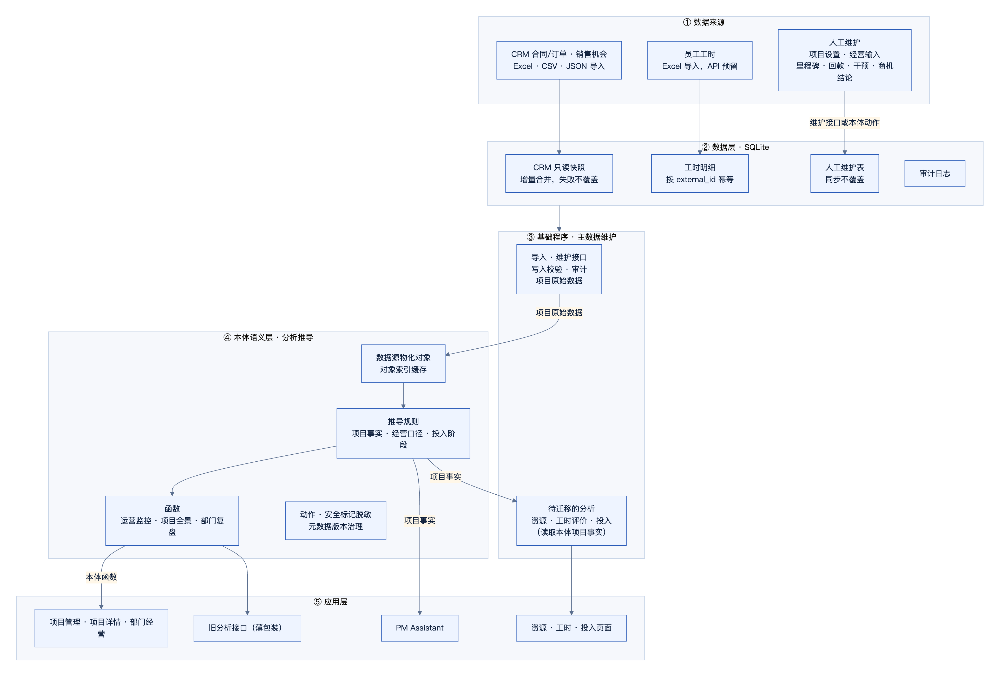

- **数据来源**：CRM 和工时是系统接口数据，只读。人工维护数据经由维护接口或本体「动作」写入，两条路径都做权限检查并写审计日志。
- **数据层**：CRM 每次导入生成一个只读快照，导入失败时保留上一次成功的版本。人工维护的数据存在独立的表里，CRM 同步永远不会覆盖它们。
- **基础程序**：导入 CRM 与工时（新增、修改都以导入为准），保存人工维护的数据。导入后的补充维护不在这一层操作：它由本体动作调用基础程序完成写入。基础程序不计算任何项目分析指标。资源运营监控、员工工时评价和投入成本分析的计算暂时还在这一层（第二、三阶段迁移），但它们使用的项目事实已经来自本体。
- **本体语义层**：数据源把基础数据物化为项目等业务对象；推导规则（`projectFacts`、`projectInvestment`、`maintenanceStatus`、`paymentTermFacts`）按元数据声明的顺序算出风险、预算消耗、回款汇总、待办和异常提醒，每个派生属性用 `derivedFrom` 指明由哪条规则计算，输出与元数据不一致时服务直接报错。推导结果缓存在对象索引中，任何写入都会让相关缓存失效。函数在对象之上计算带参数的分析（期间健康度、部门复盘），并按安全标记脱敏。第 8 章有详细说明。
- **应用层**：项目管理页、项目详情抽屉和部门经营页通过本体函数读取（`portfolioHealth`、`projectOverview`、`departmentOperatingReview` 等）。原有的分析接口保留一个版本，内部调用同一批函数，返回格式不变。PM Assistant 从本体读取项目事实，只把 CRM 文本检索交给基础程序。
- **维护**：导入后的补充维护（项目设置、里程碑、回款约定与节点、管理干预、年度计划）全部是本体动作，校验、权限和审计只有一套；项目详情抽屉和部门经营直接调用动作，原维护接口保留一个版本、改为调用同一动作。「哪些需要维护」在本体元数据中声明为维护要求，本体推导出每个对象「哪些已维护、哪些待维护」，可以查询和统计。系统设置页的运营参数暂时仍走基础程序接口。

### 3.2 信息架构

左侧菜单分四组，PM Assistant 以悬浮按钮的形式出现在每个页面右下角。

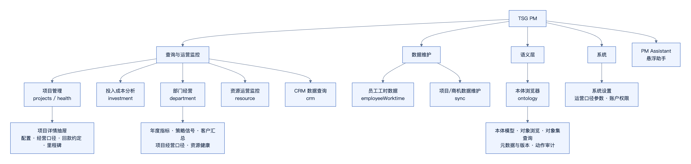

### 3.3 页面清单

| 菜单分组 | 页面 | 一句话说明 | 章节 |
| --- | --- | --- | --- |
| 查询与运营监控 | 项目管理 | 项目台账与运营监控合一的主表 | [6.1](#61-项目管理) |
| 查询与运营监控 | 项目详情抽屉 | 单个项目的全部信息与日常维护入口 | [6.2](#62-项目详情抽屉) |
| 查询与运营监控 | 投入成本分析 | 按项目代码看人天投入和沉没成本 | [6.3](#63-投入成本分析) |
| 查询与运营监控 | 部门经营 | 年度指标对照、策略信号、产能利用率、资源健康 | [6.11](#611-部门经营) |
| 查询与运营监控 | 资源运营监控 | 人员负荷与调剂建议 | [6.4](#64-资源运营监控) |
| 查询与运营监控 | CRM 数据查询 | CRM 原始记录查询与导出 | [6.5](#65-crm-数据查询) |
| 数据维护 | 员工工时数据 | 工时导入与员工利用率评价 | [6.6](#66-员工工时数据) |
| 数据维护 | 项目/商机数据维护 | CRM 文件上传与导入日志 | [6.7](#67-项目商机数据维护) |
| 语义层 | 本体浏览器 | 本体模型、对象查询、版本与审计 | [6.8](#68-本体浏览器) |
| 全局 | PM Assistant | 基于系统数据回答管理问题 | [6.9](#69-pm-assistant) |
| 系统 | 系统设置 | 运营口径参数、账户与菜单权限 | [6.10](#610-系统设置) |

---

## 4. 核心概念与数据模型

### 4.1 项目编号是唯一的关联键

**项目编号把所有数据连在一起，系统不会猜测它。** CRM 记录、工时、里程碑都按项目编号归到同一个项目。没有匹配 CRM 的工时保留原始记录，不单独生成项目；这部分投入在「投入成本分析」中作为未建档投入单列。

同一个项目编号下可以有多份合同，例如一份主合同加一份追加合同。已经成功转为合同的销售机会会并入合同，不重复展示。

### 4.2 业务对象

系统识别 12 类业务对象，它们之间有 18 种关系。图中实线是直接关联，虚线是经由工时推导出的多对多关系。「运营口径参数」不与其他对象直接关联，但几乎所有计算都引用它。

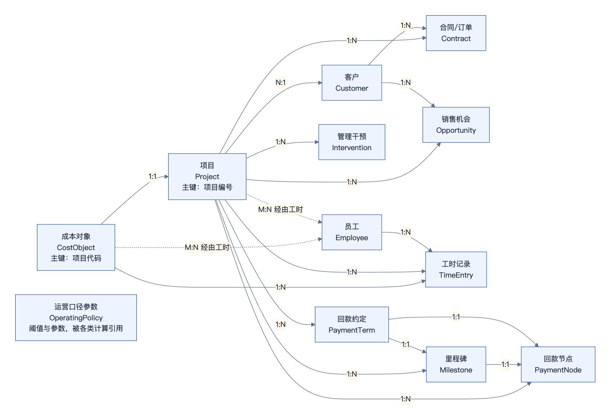

| 对象 | 是什么 | 数据从哪来 |
| --- | --- | --- |
| 项目 Project | CRM 视角的业务项目 | CRM 记录按项目编号聚合，加上人工配置 |
| 成本对象 CostObject | 工时视角的项目代码，覆盖 CRM 里没有的代码 | 工时与 CRM 中出现过的全部代码 |
| 合同/订单 Contract | 一份签约记录 | CRM 快照 |
| 销售机会 Opportunity | 一条商机记录 | CRM 快照 |
| 客户 Customer | 合同和商机的客户 | 从 CRM 记录中去重识别 |
| 员工 Employee | 填报工时的人 | 从工时记录中识别 |
| 工时记录 TimeEntry | 某人某天在某项目上的工时 | 工时导入 |
| 里程碑 Milestone | 项目的计划节点 | 人工维护 |
| 回款节点 PaymentNode | 计划的商务回款，记录到账确认 | 人工维护，或由回款约定关联里程碑后生成 |
| 回款约定 PaymentTerm | 合同里写明的回款条款，例如「首付款 30%」 | 人工维护 |
| 管理干预 Intervention | 管理者介入的事项 | 人工维护 |
| 运营口径参数 OperatingPolicy | 标准工时、利用率阈值、预算关注线等可调参数 | 系统设置或「调整运营口径」动作 |

「项目」和「成本对象」用同一个代码一一对应，但视角不同。项目只包括 CRM 里有记录的代码；成本对象包括所有填过工时的代码。所以成本对象能发现「有人在填工时，但 CRM 里还没建档」的情况。

### 4.3 数据归属：谁能改什么

每个字段都有明确的归属。这条规则保证 CRM 同步不会冲掉管理人员辛苦维护的数据。

| 归属 | 典型字段 | 更新方式 |
| --- | --- | --- |
| 系统接口，只读 | CRM 主题、客户、分类、状态、金额、开票、回款、销售人员（我方签约人） | CRM 文件导入，增量合并 |
| 系统接口，只读 | 员工填报工时、客户确认工时、加班、工作内容 | 工时 Excel 导入 |
| 人工维护 | 项目类型、项目状态、预算人天、每人天小时数、计划起止、项目经理 | 项目详情中编辑 |
| 人工维护 | 回款约定、里程碑、回款节点 | 项目详情中新增或编辑 |
| 人工维护 | 管理干预 | 本体浏览器中执行「发起管理干预」「更新干预状态」动作 |
| 人工确认 | 里程碑完成、回款到账、商机丢单或放弃 | 管理人员点击确认，系统记录确认人和时间 |
| 派生计算 | 风险、健康度、预算使用率、结算方式、投入阶段 | 系统实时计算，不能手改 |
| 运营参数 | 利用率阈值、预算关注线与高风险线、停滞天数、丢单状态、内部代码 | 系统设置，修改即时生效并写审计 |

页面上用两种标签区分来源：蓝色「系统接口 · 只读」和黄色「人工维护」。

---

## 5. 核心业务流程

### 5.1 项目全生命周期

一个项目代码从商机开始，签约后进入交付，最后关闭。工时一直记在同一个代码上，所以系统能把每个阶段的投入分开统计。

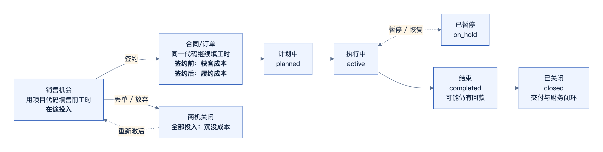

项目状态有五个取值。**人工维护的状态优先**；没有人工配置时，系统按合同的来源状态推导，再推导不出就是「计划中」。推导规则见[业务规则与计算口径](../BUSINESS_RULES.md#11-项目状态)。

| 状态 | 编码 | 含义 |
| --- | --- | --- |
| 计划中 | `planned` | 已有商机或合同，尚未开工 |
| 执行中 | `active` | 正在交付 |
| 已暂停 | `on_hold` | 暂时停止 |
| 结束 | `completed` | 交付完成，可能仍有回款 |
| 已关闭 | `closed` | 交付和财务都已闭环 |

销售机会的 CRM 状态决定它是否已签约：「成功」表示已签约；「跟踪」表示仍是商机；「失败」和「失效」表示商机已结束，售前投入计为沉没成本。销售阶段不作为判断依据。

### 5.2 数据导入与人工维护

数据进入系统后，项目管理者补齐 CRM 没有的管理字段；系统据此计算风险和待办；到期后再由人工确认结果。

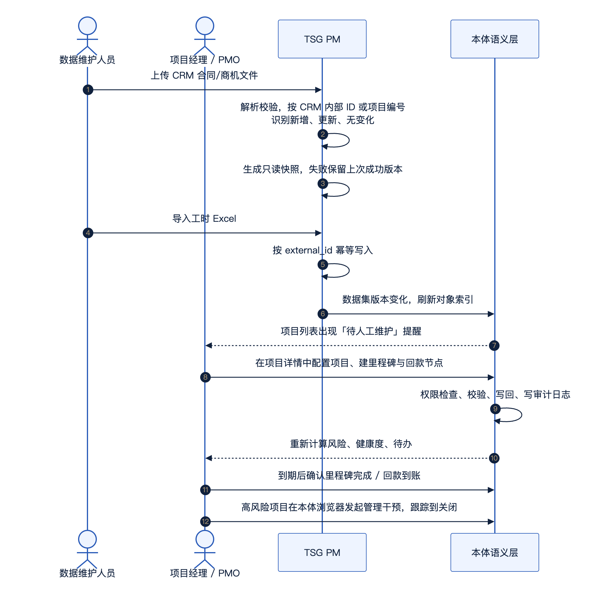

导入完成后，缺少关键字段的项目会出现「同步后人工维护尚未完成」提醒。需要补齐的字段有三类：

- 项目类型。
- 系统实施和 TSnT365 项目的初始预算人天。
- 里程碑计划。

提醒会一直显示，直到这些字段补齐。

### 5.3 待办与确认

里程碑和回款节点的计划日期会自动生成待办，系统按当天日期计算紧急程度。

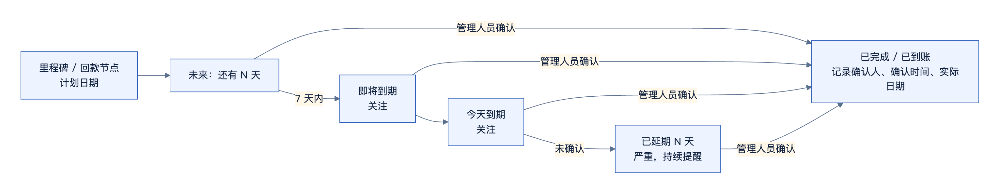

- 里程碑完成和回款到账是两个独立的确认动作。
- 确认时记录确认人、确认时间，以及实际完成日期或到账金额。
- 逾期且没有确认的事项会一直保持「严重」，并让项目风险升为严重。

### 5.4 管理干预闭环

当项目风险较高时，管理者在本体浏览器中对该项目执行「发起管理干预」动作，填写事项、负责人和截止日期。干预有三个状态：待处理、处理中、已关闭。每次状态变化都写入审计日志，所以事后能追溯谁在什么时候做了什么。

---

## 6. 功能需求

> 截图来自本地预览环境的演示数据，数字仅用于说明界面。

### 6.1 项目管理

**目标：用一张表同时看项目台账和期间运营情况，并从这里进入项目维护。**

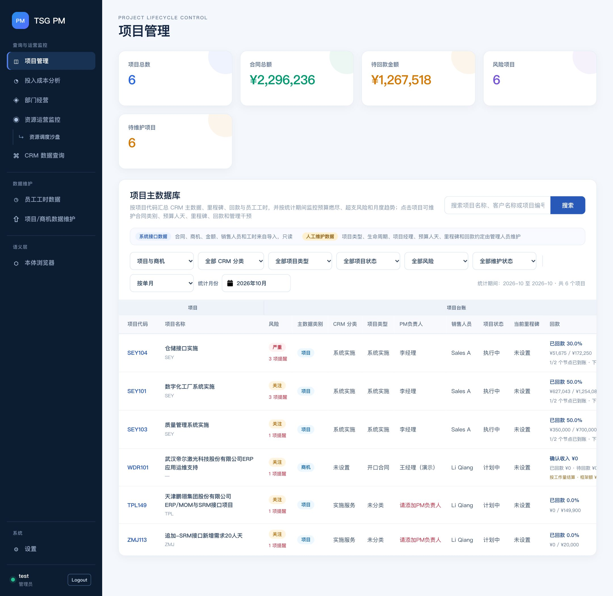

**页面结构**

1. **指标卡**：项目总数、合同总额、待回款金额、风险项目数（严重加关注）、待维护项目数（维护要求未全部满足的项目）。
2. **筛选区**：
   - 主数据类别：项目或商机。
   - CRM 分类：取当前数据中出现过的 CRM 分类。
   - 项目类型：系统实施、TSnT365、开口合同、售前阶段、未分类。
   - 项目状态：只列出当前数据中出现过的状态。
   - 风险：严重、关注、健康。
   - 维护状态：待维护、已维护（按本体推导的维护清单）。
   - 统计期间：按单月，或按月份区间。
   - 搜索：按项目名称、客户或项目编号搜索。
3. **项目主表**：表头分三组。

| 列组 | 列 |
| --- | --- |
| 项目 | 项目代码、项目名称（含客户） |
| 项目台账 | 风险、主数据类别、CRM 分类、项目类型、PM 负责人、销售人员、项目状态、当前里程碑、回款 |
| 运营监控（随统计期间变化） | 计划周期、预算消耗、月均预算、本期投入、上期投入、参与人数、超支预警、月度趋势、综合健康状态、预算耗尽预测与剩余预算 |

**交互规则**

- 默认排序：先按风险（严重、关注、健康），再按健康状态（已超预算、需关注、无基线、健康）。
- 拥有 `projects` 权限的用户点击行，打开项目详情抽屉；只有 `health` 权限的用户只能查看。
- 项目代码和名称两列在横向滚动时固定在左侧。
- 风险标签下方显示提醒条数，例如「1 项提醒」。
- 每次加载 50 个项目，底部「加载更多项目」继续加载。
- 「回款」列按结算方式显示：按合同额结算显示回款比例和金额；按工作量结算显示确认收入、已回款、待回款和框架额。下方再显示下一回款约定和回款节点进度。
- 「上期投入」是紧邻本期、月数相同的前一个期间，单元格下方标出它的月份范围。

**字段口径**：主数据类别、结算方式、超支预警、健康状态、月度趋势和预算耗尽预测的计算方法见 [7.3](#73-项目指标口径) 和 [7.4](#74-健康度与超支预警)。

### 6.2 项目详情抽屉

**目标：在一个抽屉里看完单个项目的全部信息，并完成所有人工维护。**

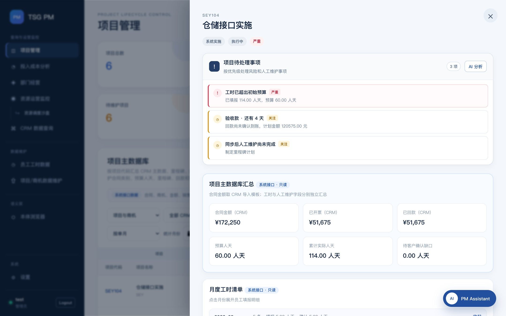

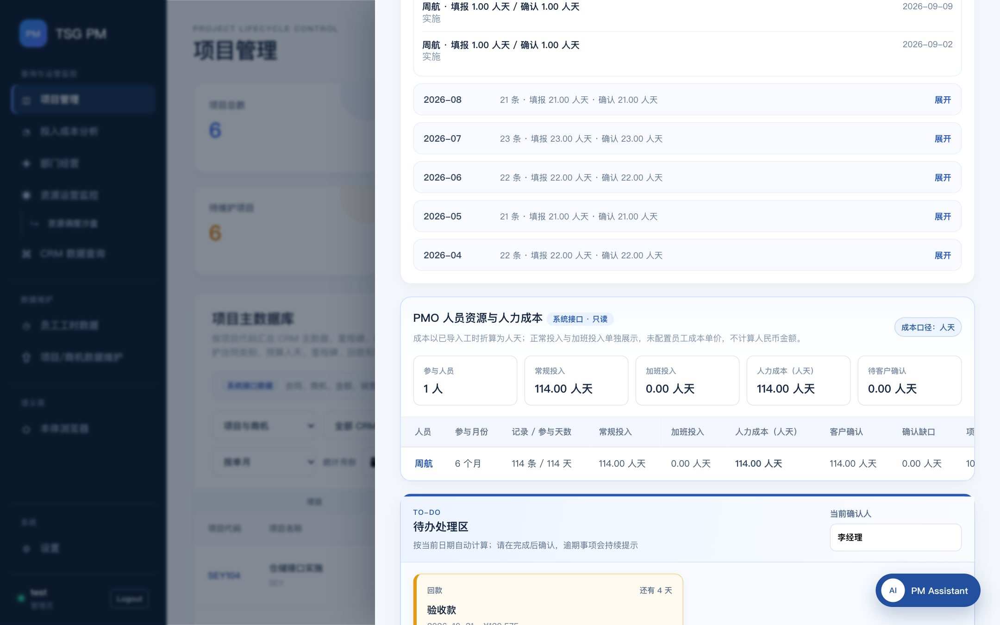

抽屉从上到下分为以下区块：

| 区块 | 来源 | 内容 |
| --- | --- | --- |
| 标题与标签 | 混合 | 项目编号、名称、项目类型、项目状态、风险等级 |
| 项目待处理事项 | 派生 | 按严重程度排列的提醒；「AI 分析」按钮生成项目研判 |
| 项目主数据库汇总 | 系统接口 | 合同额、已开票、已回款、预算人天、累计实际人天、待客户确认缺口 |
| 月度工时清单 | 系统接口 | 按月汇总，点击月份展开员工填报明细 |
| 待办处理区 | 派生 | 里程碑和回款待办，可在此确认完成或到账；已完成事项单独列出，便于复核 |
| 项目基础配置 | 人工维护 | 项目类型、项目状态、初始预算人天、每人天小时数、计划起止、项目经理；同时显示 CRM 销售人员 |
| 合同回款约定 | 人工维护 | 登记回款条款的名称、比例和金额，不要求填写绝对日期 |
| 里程碑计划 | 人工维护 | 新增、编辑、删除里程碑；可关联一个回款约定，系统以里程碑结束日期生成回款节点 |

**提醒类型**

| 提醒 | 严重程度 | 触发条件 |
| --- | --- | --- |
| 工时已超出初始预算 | 严重 | 预算使用率超过 100% |
| 工时预算接近上限 | 关注 | 预算使用率达到预算关注线（默认 80%） |
| 存在客户未确认工时 | 关注 | 员工填报工时多于客户确认工时 |
| 里程碑或回款到期 | 7 天内到期为关注，逾期为严重 | 未确认且即将到期或已逾期 |
| 同步后人工维护尚未完成 | 关注 | 缺项目类型、预算人天或里程碑计划 |

**维护规则**

- 抽屉顶部的**维护清单**列出项目适用的每条维护要求（选择项目类型、填写初始预算人天、指定项目经理、填写计划开始日期、填写计划结束日期、制定里程碑计划；售前阶段和已结束、已关闭的项目不要求项目经理和计划起止），已维护的打勾，待维护的提示到哪个区块处理；清单由本体推导，要求在本体元数据中维护。
- 抽屉中的每次保存都是一个本体动作（设置项目、新建里程碑、新建回款约定等），由动作做校验、权限检查并写审计日志；与本体浏览器中执行同名动作完全相同。
- 管理干预目前在本体浏览器中发起和更新状态，抽屉中暂不提供入口。
- 已到账的回款节点受保护：不能取消关联或删除，编辑约定也不会改动它。
- 开口合同没有预算上限，不要求填写预算人天；按工作量结算的项目不出现两条预算提醒。
- 项目经理是独立的人工维护字段，不再用 CRM 销售人员填充。

### 6.3 投入成本分析

**目标：把每个项目代码的全部工时，按商机结果拆分为有效投入和沉没成本，用于复盘售前投入效率。**

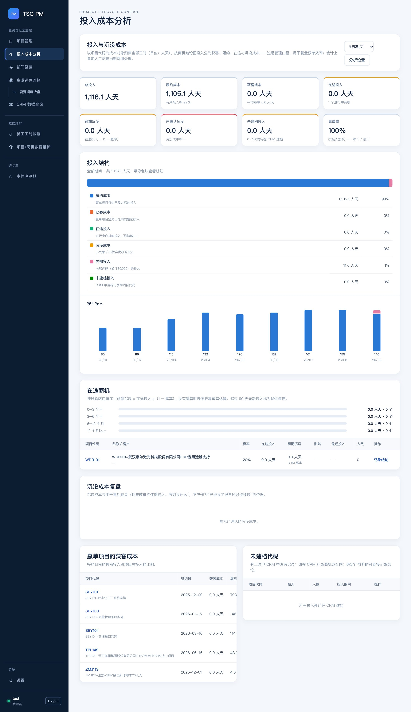

**核心逻辑**：售前阶段和交付阶段的工时都记在同一个项目代码上。系统根据这个代码最终有没有签约，以及工作日期在签约日之前还是之后，把每条工时归入六类投入之一。判定规则见 [7.6](#76-投入阶段判定)。

| 投入类别 | 含义 | 管理问题 |
| --- | --- | --- |
| 履约成本 | 赢单项目签约日及之后的投入 | 交付花了多少 |
| 获客成本 | 赢单项目签约日之前的投入 | 签一单要投入多少 |
| 在途投入 | 还没有结论的商机已经投入的工时 | 现在有多少投入处在风险中 |
| 沉没成本 | 已丢单或已放弃商机的全部投入 | 有多少投入收不回来 |
| 内部投入 | TSG999 等内部代码 | 内部事务占用多少 |
| 未建档投入 | CRM 中没有记录的代码 | 有多少工时缺少业务归属 |

**页面结构**

1. **期间与设置**：选择全部期间或月份区间。「分析设置」可配置四项：
   - 标准人天成本（元）。
   - 停滞判定天数（默认 90 天）。
   - CRM 中表示丢单的状态（默认「失败」）。
   - 内部代码清单（默认 TSG999）。
2. **8 个指标卡**：总投入、履约成本、获客成本、在途投入、预期沉没、已确认沉没、未建档投入、赢单率。
3. **投入结构**：一条按类别着色的比例条，加一张图例表，列出各类别的人天和占比。
4. **按月投入**：每月一根堆叠柱，鼠标悬停显示明细。
5. **在途商机**：
   - 账龄分布：0–3 个月、3–6 个月、6–12 个月、12 个月以上。
   - 列表按风险敞口排序，显示赢率、在途投入、预期沉没、账龄、最近投入、人数。
   - 超过停滞天数没有新工时的商机标为「疑似停滞」。
   - 可直接「记录结论」，标记为已丢单或已放弃。
6. **沉没成本复盘**：按原因汇总沉没投入，列出每个沉没代码；可「重新激活」，激活时必须填写理由。
7. **赢单项目的获客成本**：每个赢单项目的签约日、获客成本、履约成本和获客占比。
8. **未建档代码**：有工时但 CRM 没有记录的代码，按投入排序，默认显示前 10 个。

**关键指标口径**

| 指标 | 计算方法 |
| --- | --- |
| 预期沉没 | 在途投入乘以（1 减赢率）；CRM 没填赢率时，用历史赢单率估算 |
| 赢单率（按数量） | 赢单数除以有结论的商机数 |
| 赢单率（按投入加权） | 获客成本除以（获客成本加沉没成本） |
| 沉没成本率 | 沉没成本除以（沉没成本加获客成本） |
| 平均获单成本 | 获客成本除以赢单项目数 |
| 有效投入率 | （履约成本加获客成本）除以总投入 |

**规则与边界**

- 计量单位是人天，等于工时除以项目的每人天小时数（默认 8）。
- 配置标准人天成本后才折算金额。金额带 `FINANCE` 标记，没有金额权限的人看不到，也不能修改单价。
- 这是管理口径。按《企业会计准则第 14 号——收入》，售前人工在会计上照常当期费用化。
- 沉没成本只用于事后复盘，不能作为「已经投了很多所以继续投」的理由。是否继续投入某个商机，要看在途投入和预期沉没。

完整的财务口径和设计说明见 [投入成本模型](../INVESTMENT_COST_MODEL.md)。

### 6.4 资源运营监控

**目标：从人员负荷和项目缺口两端，找出可以调剂的人力。**

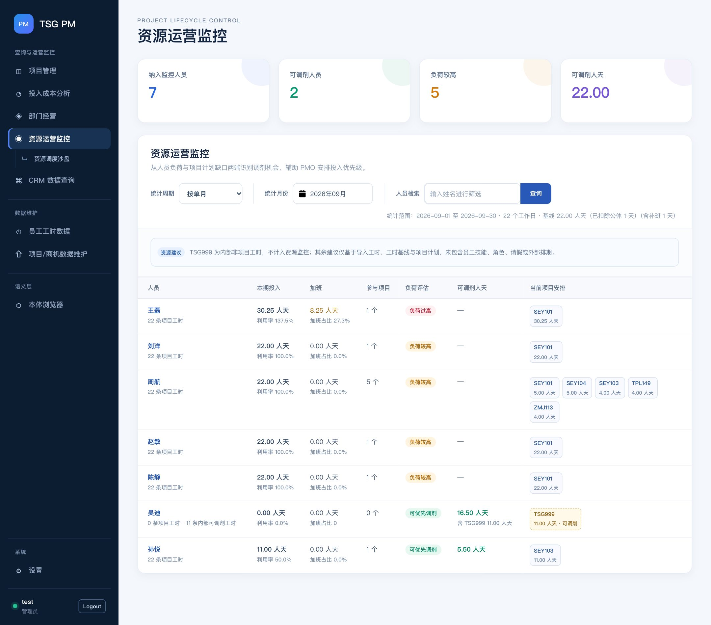

**页面结构**

1. **指标卡**：纳入监控人员、可调剂人员、负荷较高人员、需补充资源的项目数。
2. **筛选**：统计周期（单月或区间）、统计月份、按姓名检索人员。
3. **优先补充资源项目**：计划期内、本期投入低于月度计划 70% 的项目。项目必须维护了计划起止和预算人天，才会参与推算。
4. **人员负荷表**：本期投入、加班、参与项目数、负荷评估、可调剂人天，以及当前项目安排。

**负荷评估规则**（以当期工作日基线工时为 100%；阈值可在系统设置中调整）

| 工时利用率 | 负荷评估 | 可调剂人天 |
| --- | --- | --- |
| ≤ 60% | 可优先调剂 | 补到最低目标 75% 还差的人天 |
| 60%–75% | 可适度支持 | 补到最低目标 75% 还差的人天 |
| 75%–90% | 安排基本均衡 | 0 |
| 90%–100% | 负荷较高 | 0 |
| > 100% | 负荷过高 | 0 |

当期基线工时按中国工作日历计算：周一至周五，扣除法定节假日，加上调休补班日。人员按员工 ID 汇总，同名员工不会被合并。

TSG999 是内部非项目工时，不计入项目负荷。但它占用的时间可以改投项目，所以「可调剂人天」取内部工时和产能缺口两者中较大的一个。负荷较高或过高的人员例外：即使有内部工时，也不显示可调剂人天。

**边界**：建议只基于导入的工时、工时基线和项目计划。系统没有员工技能、角色、请假和外部排期数据，所以调剂前仍需项目经理确认。

### 6.5 CRM 数据查询

**目标：保留 CRM 原始记录，用于审计和追溯。**

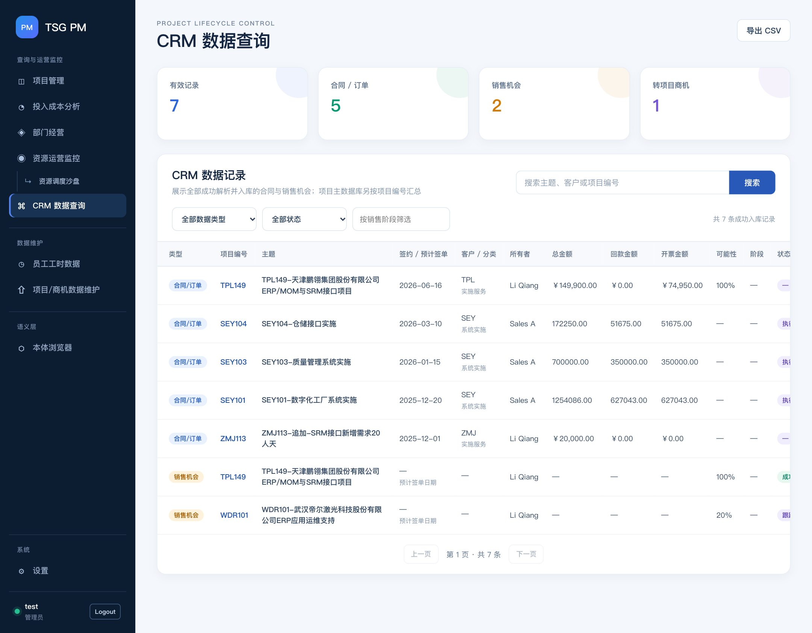

- 指标卡：有效记录、合同/订单、销售机会、已转项目的商机。
- 按记录类型、状态筛选，按主题、客户或项目编号搜索，分页浏览。
- 列：类型、项目编号、主题、签约时间、客户与类别、所有者、合同额、回款、开票、可能性、状态。
- 右上角「导出 CSV」导出当前快照。

### 6.6 员工工时数据

**目标：导入员工工时，并评价每个人的工时利用率。**

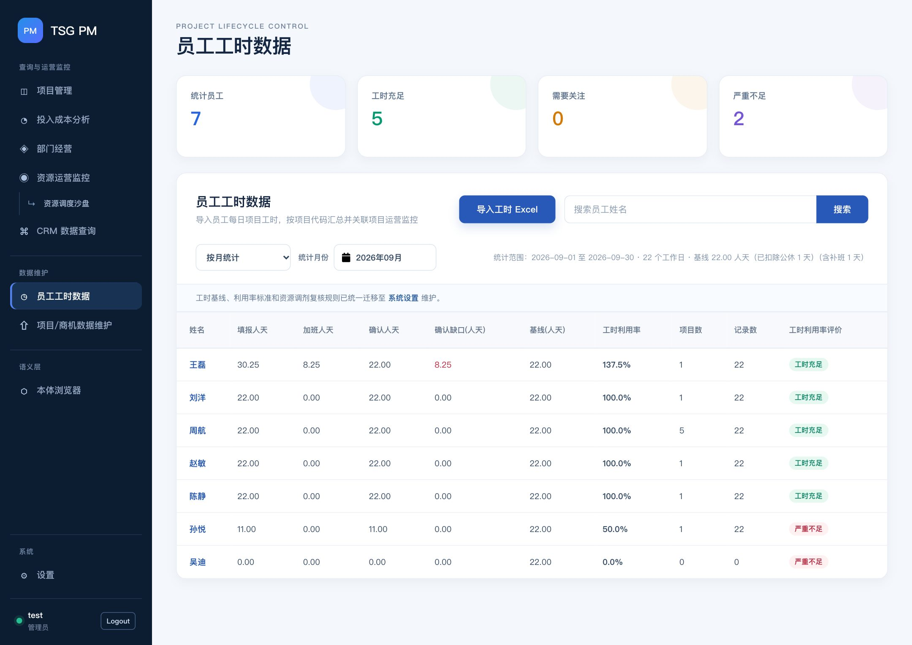

**功能**

- **导入工时 Excel**：支持旧模板和导出明细模板。导出明细的天数和加班天数各乘以固定 8 小时换算成小时；一条记录的正常工时加加班不超过 24 小时。
- **去重与更新**：Excel 按人员、项目、日期、工时和工作内容识别重复，重复导入不增加记录；重复记录的审批状态只向前更新（已提交 → 已确认或已驳回，计入「更新」），已确认、已驳回不会被旧文件改回。接口数据按 `external_id` 识别；来源更新时间更新时覆盖旧记录，所以来源系统后来的审批变化能同步进来。导入结果显示新增、更新和无变化三个数字。
- **统计口径**：按月或按年统计，可按员工姓名搜索。基线工时按中国工作日历计算，人员按员工 ID 汇总。
- **工时基线参数**：已移到「系统设置 → 运营评估与产能基线」，见 [6.10](#610-系统设置)。

**员工列表**：填报人天、加班人天、确认人天、确认缺口、基线、工时利用率、项目数、记录数、评价。

**利用率评价**

| 工时利用率 | 评价 |
| --- | --- |
| > 优秀线（默认 90%） | 工时充足 |
| > 最低线（默认 75%） | 基本达标 |
| > 关注线（默认 60%） | 需要关注 |
| ≤ 关注线 | 严重不足 |

边界值落入较低一档。

内部非项目代码 TSG999 的工时不计入利用率。

### 6.7 项目/商机数据维护

**目标：导入 CRM 合同和商机数据，并保留导入记录。**

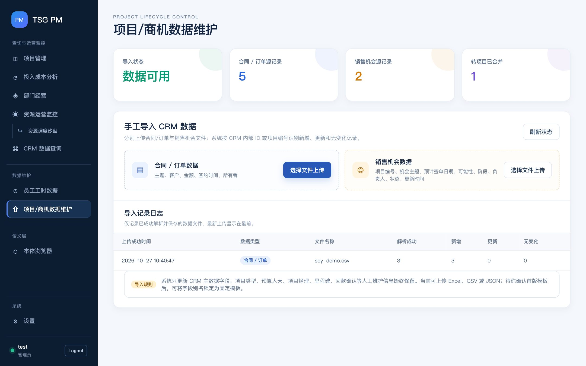

- **两个上传入口**：合同/订单数据（主题、我方签约人、签约时间、分类、状态、总金额、回款金额、开票金额），销售机会数据（主题、负责人、预计签单日期、可能性、销售阶段、状态）。
- **支持格式**：Excel、CSV（UTF-8 或 GBK 编码）、JSON。
- **识别规则**：按 CRM 内部 ID 或项目编号，把每条记录识别为新增、更新或无变化。
- **导入记录日志**：只记录成功解析并保存的文件，最新的在最前。
- **指标卡**：导入状态、合同源记录数、商机源记录数、已合并到项目的商机数。

**导入规则**：系统只更新 CRM 主数据字段。项目类型、预算人天、项目经理、里程碑、回款确认等人工维护信息始终保留。导入失败时，系统继续使用上一次成功的快照。

### 6.8 本体浏览器

**目标：让产品和技术人员看到并检验系统的业务模型。**

本体是系统对业务世界的一份「说明书」：有哪些对象、对象有哪些属性、对象之间什么关系、能对对象做哪些操作。第 8 章介绍它的设计，本节介绍浏览器的五个标签页。

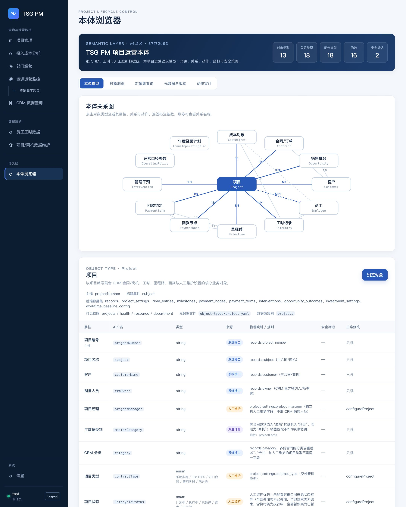

| 标签页 | 内容 |
| --- | --- |
| 本体模型 | 对象关系图；点击对象，查看属性、来源、物理映射、安全标记和可修改它的动作 |
| 对象浏览 | 按对象类型浏览对象，沿关系跳转，执行动作和函数 |
| 对象集查询 | 可视化组合过滤条件、集合运算、沿关系检索和聚合 |
| 元数据与版本 | 元数据文件、版本历史、两个版本之间的结构差异 |
| 动作审计 | 所有动作的执行记录：谁、何时、改了哪个对象、改了什么 |

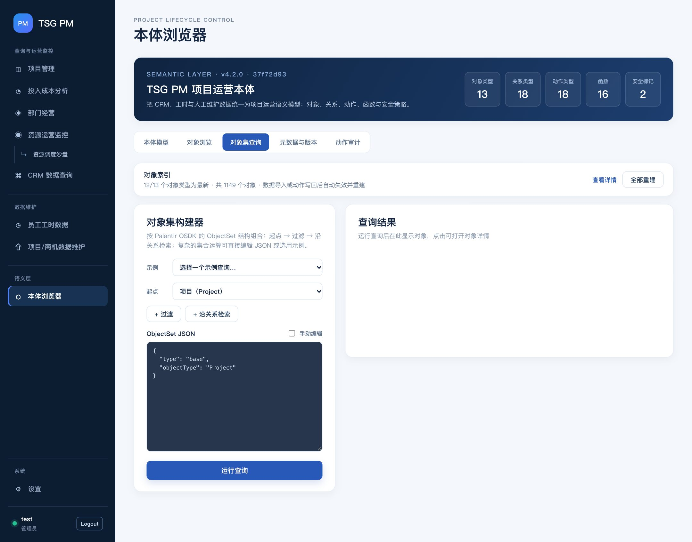

**对象集查询**的用法：先选一个对象类型，再叠加条件，例如「项目类型为系统实施、且风险为严重」；可以把两个结果集求并集、交集或差集，也可以沿关系检索，例如「这些项目的全部工时」；最后按字段分组统计。结果可以分页加载。

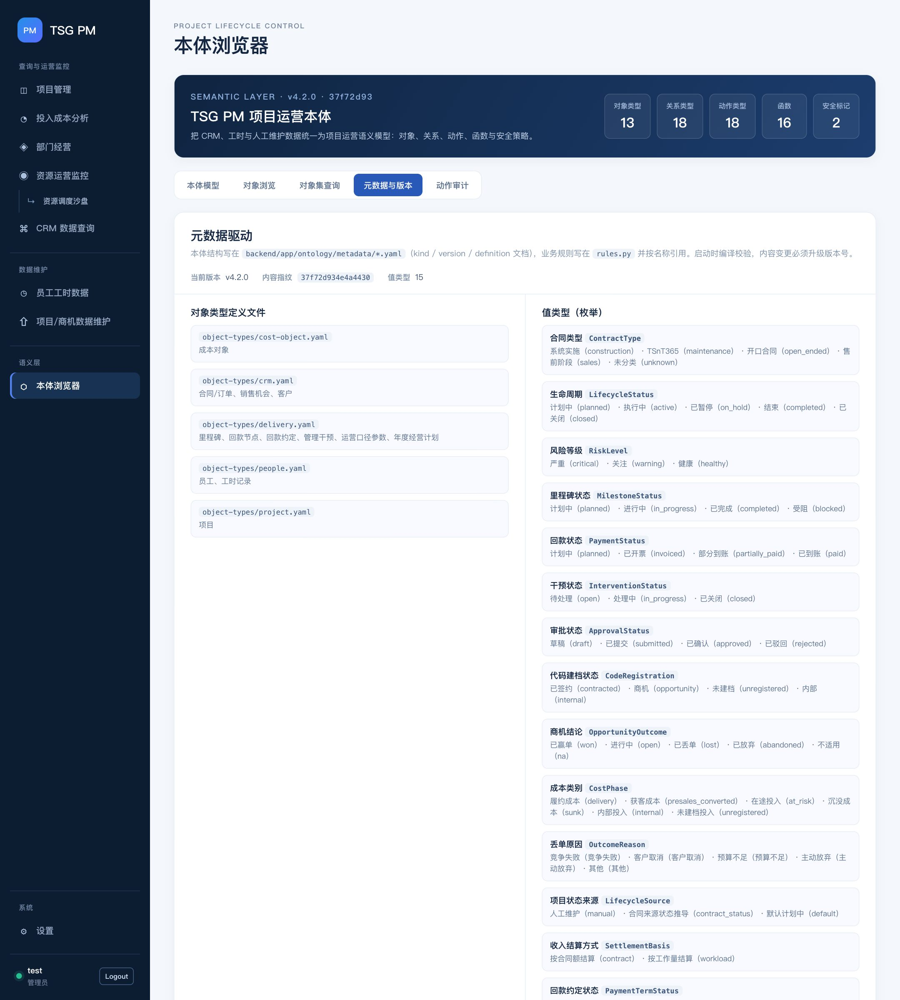

**函数结果**以可读的卡片和表格展示，原始 JSON 默认折叠，需要时再展开。v1.1 新增两个函数：「中国工作日历」统计任意期间的法定工作日和基线工时；另一个函数「资源调度沙盘」已于 v5.0.0 随功能取消。

本体中还新增了两类对象：「回款约定」可以在对象浏览中新建、编辑、删除；「运营口径参数」只有一个对象，可执行「调整运营口径」动作。

### 6.9 PM Assistant

**目标：让管理者用自然语言询问项目情况。**

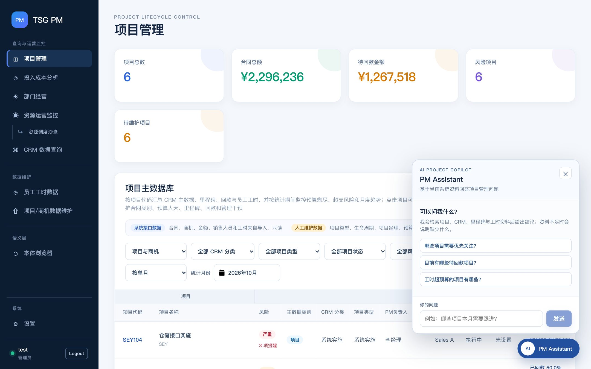

- 悬浮在页面右下角，拥有 `projects` 权限的用户可以使用。
- 提供示例问题，例如「哪些项目需要优先关注？」「工时超预算的项目有哪些？」。
- 回答前先检索系统里的项目、CRM、里程碑和工时资料，回答附带资料来源；资料不足时会说明缺什么。
- 项目详情中的「AI 分析」按钮，用同样的能力对单个项目生成研判。
- 当前由服务端调用 OpenAI Responses API，模型可配置。服务端没有配置模型服务时，助手提示「尚未配置模型服务，请联系管理员」。

### 6.10 系统设置

**目标：维护全系统的计算口径参数，并管理账户和菜单权限。**

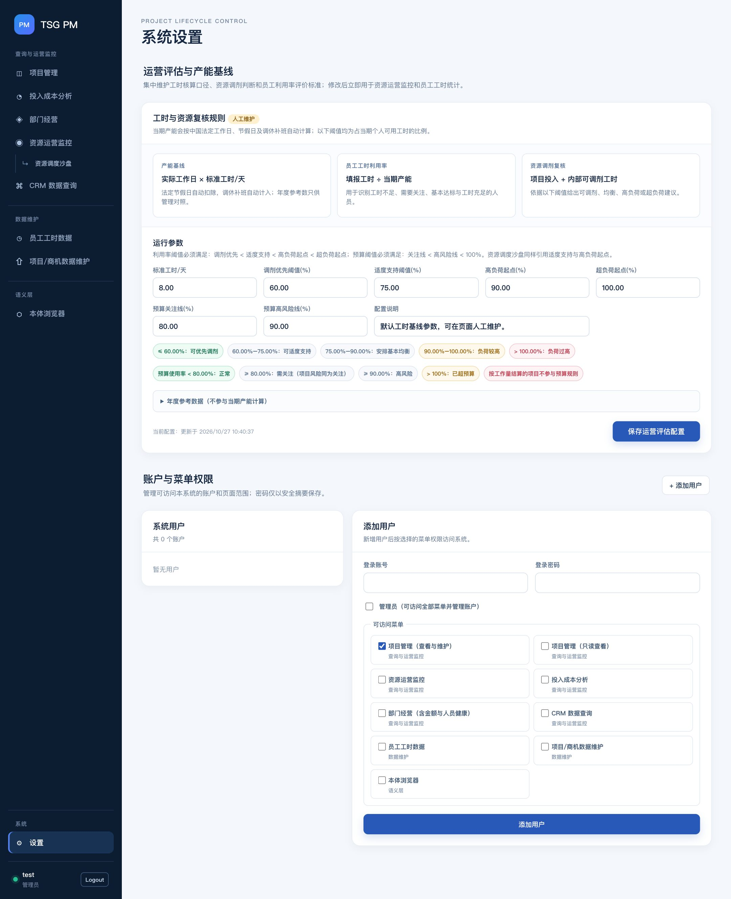

- 仅管理员可见。
- **运营评估与产能基线**：标准工时/天、利用率四档阈值（调剂优先、适度支持、高负荷起点、超负荷起点）、预算关注线和预算高风险线。页面下方用标签实时说明当前规则，例如「≥ 80%：需关注」。年度参考数据折叠显示，不参与当期计算。
- 阈值必须满足：利用率 调剂优先 < 适度支持 < 高负荷起点 < 超负荷起点；预算 关注线 < 高风险线 < 100%。保存后立即作用于项目风险、运营监控、员工评价和资源监控，并写入审计日志。
- **账户与菜单权限**：新增用户时填写登录账号和密码，选择是否为管理员；非管理员逐项勾选可访问的菜单。
- 密码只保存安全摘要，不保存明文。
- 登录后按权限显示菜单；访问无权限的接口返回 403。

### 6.11 部门经营

**目标：让部门管理者按年度经营目标看部门运营，并找到需要推动验收、补充合同或释放资源的地方。**

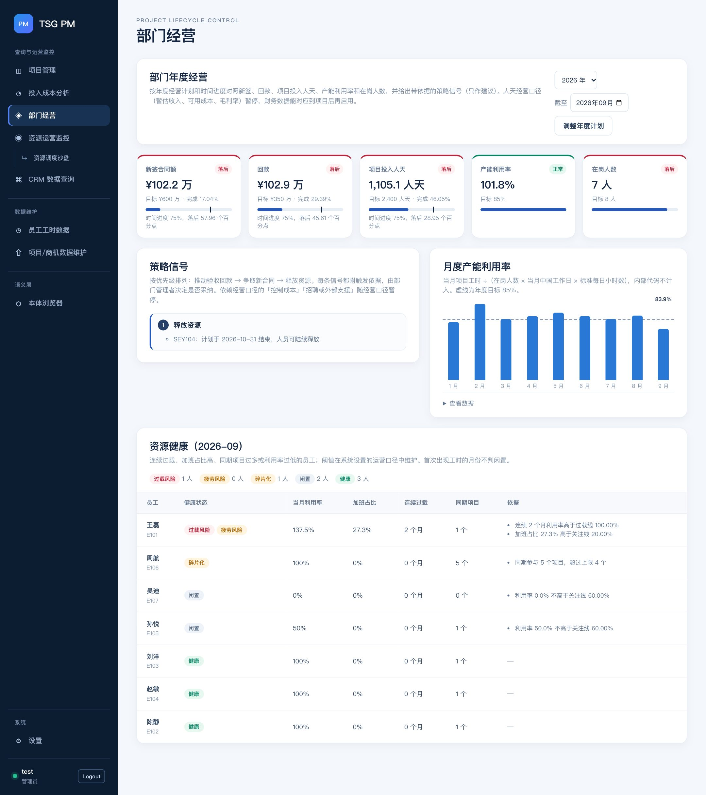

- **年度与截至月份**：缺省截至本月与最近有工时的月份中较早者。「设定 / 调整年度计划」维护新签合同额、回款、项目投入人天、人员编制和利用率目标；未填的目标显示「无目标」。
- **年度指标**：5 个指标卡。新签、回款、投入人天是累计指标，进度条上的竖线是时间进度，完成率落后时间进度超过容差（默认 5 个百分点）标为「落后」；利用率和在岗人数直接与目标比较。
- **策略信号**：按优先级列出推动验收回款（回款节点逾期，或交付结束仍未回款）、争取新合同（最近一月利用率不高于关注线）、释放资源（计划次月内结束且本月仍有投入），每条附触发依据。信号只是建议，系统不自动执行。
- **月度产能利用率**：每月项目工时 ÷（在岗人数 × 工作日 × 标准每日小时数），虚线是年度目标；可展开数据表。
- **资源健康**：当月填报工时的员工按过载、疲劳、碎片化、闲置、健康分类，显示利用率、加班占比、连续过载月数、同期项目数和依据。
- **暂停的内容（v1.4）**：人天经营口径（暂估收入、可用成本、可支配人天、动态成本、毛利率、成本超前、经营状态）需要合同人天单价等财务字段，财务数据还不能对应到项目，因此连同项目组合、客户经营汇总、项目经营口径、确认收入与毛利率目标、「控制成本」「招聘或外部支援」信号一起暂停。规则卡和计算方法保留，以后在本体中新建属性维护后再启用。

口径详见 [业务规则 §11](../BUSINESS_RULES.md#11-部门经营口径本体-300)。

---

## 7. 业务规则汇总

> 本章是规则摘要。完整的计算口径、每条口径在本体中的位置，以及本次优化的 7 项口径，见[业务规则与计算口径](../BUSINESS_RULES.md)。

### 7.1 项目类型

「项目类型」是人工维护的交付管理类型，与 CRM 的「分类」不是同一字段。

| 类型 | 编码 | 预算人天 | 管理方式 |
| --- | --- | --- | --- |
| 系统实施 | `construction` | 必填 | 实际人天对比预算人天，识别超支 |
| TSnT365 | `maintenance` | 必填 | 在服务周期内跟踪消耗和剩余 |
| 开口合同 | `open_ended` | 无上限 | 按工作量结算，按客户审批通过的工时形成可结算人天 |
| 售前阶段 | `sales` | 可选 | 重点跟踪商机投入 |
| 未分类 | `unknown` | 空 | 进入人工维护提醒 |

每个项目默认 1 人天 = 8 小时，可以在项目基础配置中调整。注意：Excel 导入时把「天数」换算成小时固定用 8 小时，修改项目的每人天小时数只改变展示的人天，不改变源工时。

### 7.2 风险等级

风险等级分严重、关注、健康三档。系统每次读取时按当天日期和最新数据计算，所以跨天后逾期状态会自动更新。

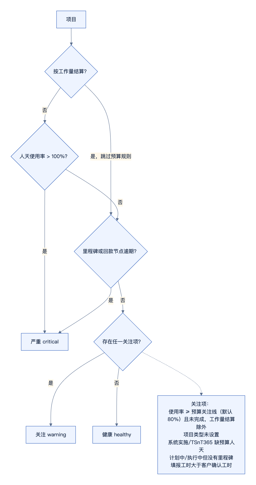

### 7.3 项目指标口径

| 指标 | 计算方法 |
| --- | --- |
| 合同金额 / 已开票 / 已回款 | 该项目全部合同记录对应金额之和 |
| 结算方式 | 项目类型为开口合同，或开票/回款金额超过合同总额时，按工作量结算；否则按合同额结算 |
| 回款率 | 按合同额结算时为已回款 ÷ 合同金额，页面限制在 0%–100%；按工作量结算时不显示 |
| 待回款 | 按合同额结算：max（合同金额 − 已回款，0）；按工作量结算：max（开票 − 已回款，0） |
| 确认收入 | 按工作量结算时取 CRM 开票金额，是代理口径，不是财务收入确认账 |
| 已填报人天 | 有效工时（已提交和已确认）的正常工时加加班工时，除以每人天小时数；不以审批通过为前提，已驳回和草稿不计入 |
| 客户确认人天 | 只统计审批状态为 approved 的确认工时 |
| 客户确认缺口 | max（已填报 − 客户确认，0），大于 0 时提醒 |
| 预算使用率 | 已填报人天除以预算人天 |
| 可结算人天 | 开口合同中客户审批通过的人天 |
| 主数据类别 | 有合同或状态为「成功」的商机为「项目」，否则为「商机」 |
| CRM 分类 | 多份合同的分类去重后用「、」合并 |
| 月均预算 | 预算人天除以计划月数（自然月差加 1） |
| 月度趋势 | 本期对比紧邻的同长度上期：增减 10% 以上为上升或下降，否则为持平；上期为 0 时为新增投入 |
| 预算耗尽预测 | 剩余预算 ÷（本期投入 ÷ 统计月数），从统计结束月起向上取整推算耗尽月份；这不是项目完工预测 |

### 7.4 健康度与超支预警

超支预警看预算消耗，综合健康状态再叠加风险等级。**项目风险与运营监控共用同一套预算阈值**，在系统设置中调整。

| 超支预警 | 条件 |
| --- | --- |
| 待维护预算 | 没有预算人天 |
| 工作量结算 | 按工作量结算的项目，不做预算预警 |
| 已超预算 | 累计投入超过预算 |
| 高风险 | 消耗达到预算高风险线（默认 90%） |
| 需关注 | 消耗达到预算关注线（默认 80%） |
| 正常 | 其他情况 |

综合健康状态按以下顺序判定，先满足的优先：

| 综合健康状态 | 条件 |
| --- | --- |
| 额外投入 | 所有合同的来源状态都已结束，统计期仍有工时 |
| 已超预算 | 超支预警为「已超预算」 |
| 无基线 | 超支预警为「待维护预算」 |
| 需关注 | 超支预警为高风险或需关注，或者风险等级为严重或关注 |
| 健康 | 其他情况 |

### 7.5 工时与资源阈值

所有可调的阈值都保存在本体对象「运营口径参数」中：员工工时评价、资源负荷评估共用四档利用率阈值，项目风险和运营监控共用两条预算线。修改后所有页面同时生效，见 [6.10](#610-系统设置)。

### 7.6 投入阶段判定

每条工时按下图顺序判定投入类别，先满足的条件优先。

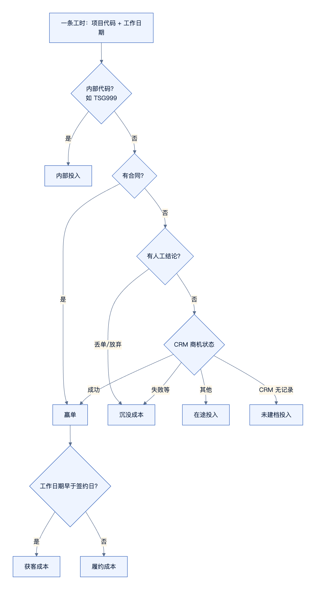

- **签约日**：同一代码有多份合同时，取最早的签订日期。CRM 商机为「成功」但还没有合同时，取商机的签单日期。两者都缺时，全部投入计为履约成本，并显示数据提示。
- **有合同的代码不会被标为沉没**：如果之前人工标记过丢单，系统忽略该结论，并显示提示。
- **结论日期不能早于首次投入日期**；已签约代码和内部代码不能记录丢单。

### 7.7 动作执行规则

动作是本体中定义的写操作，例如「配置项目」「确认回款到账」。它是人工维护数据的标准写入口，每个动作都按同一条流水线执行：

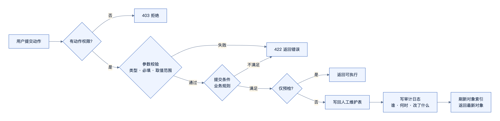

当前共 18 个动作：

| 对象 | 动作 |
| --- | --- |
| 项目 | 配置项目、发起管理干预 |
| 里程碑 | 新建、编辑、删除、确认完成 |
| 回款节点 | 新建、编辑、删除、确认到账 |
| 回款约定 | 新建、编辑、删除 |
| 管理干预 | 更新状态 |
| 成本对象 | 记录商机结论、重新激活商机 |
| 运营口径参数 | 调整运营口径（覆盖全部参数，提交前校验阈值顺序与取值范围）、设定年度经营计划 |

---

## 8. 本体语义层

### 8.1 为什么需要语义层

**分析和监控指标在语义层推导，页面从语义层读取。** 基础程序只维护主数据和关键字段；项目的风险、健康度、预算、回款和待办由本体的推导规则计算，元数据中每个派生属性都写明由哪条规则算出（`derivedFrom`），规则的输出与元数据不一致时服务直接报错。语义层同时提供业务对象和关系的查询、带校验和审计的写入动作、按安全标记脱敏，以及元数据版本治理；每条口径的公式写在对象属性的「来源」中，可以在本体浏览器里查到。第一阶段覆盖项目管理、项目详情和部门经营（见 3.1）。

本体借鉴了 Palantir Ontology 的思路，由六个部分组成：

| 组成 | 回答的问题 | TSG PM 中的例子 |
| --- | --- | --- |
| 对象类型 Object Type | 业务里有哪些东西 | 项目、员工、回款约定、年度经营计划，共 13 类 |
| 属性 Property | 这些东西有什么特征，数据从哪来，怎么算，用什么单位 | 项目类型来自人工维护；待回款的说明就是它的公式；已填报人天的量纲是「人天」 |
| 关系类型 Link Type | 它们怎么关联 | 项目有多个里程碑，共 18 种 |
| 动作类型 Action Type | 能对它们做什么 | 确认回款到账、调整运营口径、设定年度经营计划，共 17 个 |
| 推导规则 Derivation | 派生属性由谁算 | 维护状态、项目事实、投入阶段，共 3 条 |
| 函数 Function | 怎么计算带参数的分析 | 项目运营监控、项目全景、部门经营复盘、待维护清单、客户年度汇总，共 16 个 |
| 安全 Safe | 谁能看、谁能改 | 金额和人员 2 种安全标记，以及动作授权 |

### 8.2 元数据驱动与版本

本体结构写在 YAML 元数据文件中（`backend/app/ontology/metadata/`），业务规则留在代码里按名称注册。服务启动时，系统先校验元数据，再登记版本号。版本规则有三条：

- 同一个版本号的内容不能变；
- 新版本号必须比旧版本大；
- 在「元数据与版本」页可以比较两个版本的差异，并标出破坏性变更。

当前版本是 v7.4.0。v7.4.0 让统计期间支持起止日期与月份区间（里程碑），对象类型可声明列表列 listProperties。v7.3.0 让工时记录按月份查看（默认最近一个月），统计期间支持 dateProperty 与 defaultView。v7.2.0 新增统计期间（按月份查看对象），员工的月度工时、资源健康和关系随月份联动。v7.1.0 为员工增加「项目投入占比」。v7.0.0 删除里程碑动作的回款日期、回款金额和商务回款节点参数，回款节点只由回款约定产生；参数 fills 改为 optionDetails。v6.0.0 取消「新建回款节点」动作（破坏性变更，升主版本），回款节点只由回款约定关联里程碑产生。v5.5.0 让动作参数声明 fills（选中回款约定后带出金额与日期），项目新增回款约定数与待关联数。v5.4.1 修正客户「最近签订」只取合同签订日期。v5.4.0 增加签约年度维度：合同、项目的「签约年度」，客户的本年度汇总，函数「客户年度汇总」，对象浏览的年度筛选。v5.3.0 为客户增加「已回款」「已开票」汇总。v5.2.0 为销售机会增加「已转化为合同」和「销售阶段」，已转化的商机保留并标明，「签订日期」改称「预计签单日期」。v5.1.0 定义有效工时：工时记录新增「计入有效工时」，已驳回和草稿不计入任何统计；Excel 重复导入时审批状态向前更新。v5.0.0 取消资源调度沙盘，删除函数「资源调度沙盘」（破坏性变更，升主版本），资源相关分析保留资源运营监控和中国工作日历。v4.4.0 让维护要求的适用条件支持「不在」（notIn）和多条件，售前阶段和已结束、已关闭的项目不要求项目经理和计划起止。v4.3.0 追加维护要求：项目须指定项目经理、填写计划起止日期，回款约定须关联里程碑（回款约定的派生属性改由推导规则 `paymentTermFacts` 计算）。v4.2.0 让维护在本体中进行：对象类型声明维护要求，推导规则 `maintenanceStatus` 给出维护清单，函数 `maintenanceWorklist` 列出待维护对象，所有项目维护写入经由本体动作。v4.1.0 为每个数值属性声明量纲（单位），本体浏览器按量纲显示单位，金额由量纲识别。v4.0.0 暂停人天经营口径：删除财务输入、经营属性、推导规则 `projectEconomics` 与 4 个经营函数（破坏性变更）。v3.1.0 让项目分析在本体推导：新增推导规则机制，项目管理页、项目详情和部门经营改为读取本体函数（第一阶段）。v3.0.0 引入部门经营：项目人天经营口径、客户汇总、资源健康、年度经营计划与策略信号；它是破坏性变更，项目的「确认收入」改由经营口径计算（`Project.confirmedRevenue`），旧属性 `recognizedRevenueAmount` 退役。v2.0.2 在两条可能找不到对应对象的关系上声明了原因，并让系统设置页与本体动作使用相同的参数范围；v2.0.1 让「调整运营口径」动作覆盖全部参数并加上阈值顺序校验。从 v1.3.0 升到 v2.0.0 是破坏性变更：项目的「合同状态」属性已退役，由项目状态推导和结算方式取代。

### 8.3 对象集与对象索引

对象集查询沿用 Palantir OSDK 的结构，支持过滤、集合运算、沿关系检索和聚合。对象由带缓存的对象索引提供：底层数据有任何写入，数据库触发器就让相关缓存失效；导入完成后，后台自动重建索引。

详细设计见 [本体架构文档](../ONTOLOGY_ARCHITECTURE.md)。

---

## 9. 非功能需求

| 类别 | 要求 |
| --- | --- |
| 数据完整性 | 金额用十进制定点字符串，禁止浮点数；工时按 `external_id` 幂等导入，来源版本更新时才覆盖；CRM 导入失败不覆盖上次成功的快照 |
| 数据归属 | 同步任务不得覆盖或删除人工维护和人工确认字段 |
| 安全 | 账户登录，按菜单授权；金额和人员属性按安全标记脱敏；动作逐个授权 |
| 审计 | 所有动作、项目维护接口和运营参数修改都写审计日志，记录操作人、时间、对象和变更内容 |
| 性能 | 对象按类型缓存，只在相关数据变化或跨天时重建；导入后在后台预热索引；列表按游标分页，每次 50 条 |
| 可维护性 | 本体结构由元数据定义，修改必须升级版本号；启动时校验失败即拒绝启动；每次本体构建交付构建包（每条规则写依据和验收口径，例外表不能为空），并通过语法、一致性、结构缺陷、构建包四阶段诊断 |
| 质量 | 后端 214 个单元测试，前端 41 个单元测试；CI 运行测试与构建 |
| 兼容性 | 桌面浏览器优先；表格支持横向滚动，关键列固定 |

---

## 10. 当前边界与后续规划

### 10.1 当前边界

- 工时系统的真实 API 尚未确认。目前用 Excel 导入验证数据模型和幂等导入；接入 API 时只需新增一个工时数据源适配器。
- CRM 目前靠手工上传文件，尚未对接 CRM 接口。
- 工时数据不采集工时类型。售前和交付的区分，靠签约日推断。
- 资源调剂建议不含员工技能、角色和请假信息。
- 项目经理只以 TSG PM 中人工维护的为准，不再用 CRM 销售人员填充。
- 中国法定节假日来自外部日历订阅；订阅不可用时只按周一至周五计算，并在结果中标明。

### 10.2 后续规划

| 方向 | 内容 | 来源 |
| --- | --- | --- |
| 维护要求扩充 | 在本体元数据中追加维护要求，例如项目经理、计划周期、回款约定关联里程碑；系统设置的运营参数改为本体动作维护 | 用户 2026-10-27「哪些需要维护、哪些已经维护都可以通过本体查询体现」 |
| 本体推导第二阶段 | 资源运营监控、员工工时评价迁入本体（员工、工时对象的派生属性改为推导规则），页面改读本体函数并按标记脱敏 | 用户 2026-10-26「分析、监控都从本体推导」 |
| 本体推导第三阶段 | 投入成本分析迁入本体；PM Assistant 以本体对象、关系和函数作为检索上下文；原分析接口下线 | 同上 |
| 恢复人天经营口径 | 财务数据能对应到项目后，在本体对象中新建属性维护合同人天单价等输入，重新接回经营口径的推导、函数和页面（规则卡见 3.0.0 构建包，计算函数与测试已保留） | 用户 2026-10-26 |
| 部门经营管理二期 | 资源计划（计划与实际对比）、高概率商机纳入复盘参考、员工部门字段与多部门年度计划 | 本体 3.0 设计稿与构建包例外表 |
| 投入分析 | 项目详情中增加「投入分析」区块；按客户和负责人统计沉没成本；售前投入产出比 | 投入成本模型 |
| 写入统一 | 项目详情的全部编辑表单改为直接调用动作；在项目详情中增加管理干预区块 | 本体规划 v2 |
| 行级安全 | 项目经理只能看到自己负责的项目 | 本体规划 v3 |
| 系统集成 | 接入工时系统 API；员工增加部门和技能属性；对接 ERP、OA | 本体规划 v4 |

---

## 11. 术语表

| 术语 | 解释 |
| --- | --- |
| 项目编号 / 项目代码 | 关联 CRM、工时和人工维护数据的唯一键，例如 `TPL149` |
| 人天 | 工时除以每人天小时数（默认 8）得到的工作量单位 |
| 预算人天 | 项目管理者为系统实施、TSnT365 项目设定的初始投入上限 |
| 项目类型 / CRM 分类 | 前者是人工维护的交付管理类型，后者是 CRM 合同上的分类，两者不是同一字段 |
| 结算方式 | 按合同额结算或按工作量结算；后者以 CRM 开票金额作为确认收入 |
| 回款约定 | 合同里写明的回款条款，关联里程碑后生成回款节点 |
| 额外投入 | 合同来源状态都已结束，统计期仍有人填报工时 |
| 预算耗尽预测 | 按统计期投入速度推算预算哪个月用完，不是完工预测 |
| 运营口径参数 | 保存全部可调阈值和参数的本体对象，例如预算关注线 |
| 客户确认缺口 | 员工已填报、但客户尚未确认的工时 |
| 获客成本 | 赢单项目在签约日之前的投入 |
| 履约成本 | 赢单项目在签约日及之后的投入 |
| 在途投入 | 尚无结论的商机已经投入的工时，也叫风险敞口 |
| 沉没成本 | 已丢单或已放弃商机的全部投入 |
| 预期沉没 | 在途投入中，按赢率估计可能收不回的部分 |
| 未建档投入 | 工时代码在 CRM 中没有任何记录的投入 |
| 本体 | 系统对业务对象、属性、关系、操作和权限的统一定义 |
| 动作 | 本体中定义的写操作，是人工维护数据的标准写入口 |
| 函数 | 本体中定义的业务计算，例如风险评估 |
| 安全标记 | 贴在敏感属性上的标签，例如 `FINANCE`，没有权限时该属性显示为空 |
| 对象集 | 按条件、集合运算或关系组合出来的一组对象 |
| 快照 | 一次 CRM 导入后形成的只读数据版本 |

---

## 12. 文档维护方法

### 12.1 版本规则

- 文档版本跟随产品版本。新增功能时升级次版本号，例如 v1.1；只修正文字时升级修订号，例如 v1.0.1。
- 每次更新都在「修订记录」中加一行，写明改了哪些章节。
- 本体元数据升级版本时，同步更新第 8 章和文档信息表中的本体版本号。

### 12.2 每次迭代的更新清单

1. 在第 6 章新增或修改对应功能小节，写清目标、页面结构、交互和规则。
2. 业务规则有变化时，更新第 7 章的表格或流程图。
3. 新增菜单或权限时，更新第 2 章权限表和第 3 章信息架构图。
4. 重新生成截图和流程图，见下一节。
5. 第 10 章把已完成的规划移出，补充新的边界和规划。

### 12.3 重新生成图片

流程图的源文件是 `docs/prd/diagrams/*.mmd`，使用 Mermaid 语法。截图和流程图都由 `docs/prd/build-assets.mjs` 生成，需要本机安装 Google Chrome 和 Node.js。

渲染流程图（处于网络代理环境时加上 `NODE_USE_ENV_PROXY=1`）：

```bash
node docs/prd/build-assets.mjs diagrams
```

重新截图前，先用 `TSG_PM_AUTH_ENABLED=false` 启动后端，并在 5174 端口启动前端，然后执行：

```bash
node docs/prd/build-assets.mjs screenshots
```

图片输出到 `docs/prd/images/`，文件名不变，文档中的引用会自动更新。
